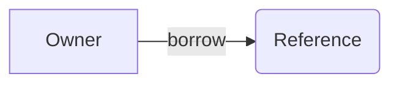

## Goal

Create a Slidev deck as a workspace app in `D:/newkub/slides/apps/{project-name}`, open the browser to view it immediately, and leave it drivable through the Slidev MCP server

## Scope

Write `slides.md` and the app's own `package.json` (`@slides/{project-name}`) with standard headmatter and per-slide frontmatter. Slidev dependencies stay in the shared root `D:/newkub/slides/package.json` — the app never declares them itself

## Execute

### 1. Create Project Directory

> Goal: Create the directory structure for the Slidev project

1. Take the project name as a parameter (e.g. `rust`)
2. Create the directory `D:/newkub/slides/apps/{project-name}` if it does not exist
3. Create the subdirectories: `components/`, `layouts/`, `public/`, `styles/`
4. Create the app `package.json` from `apps/learn-rust/package.json`: `name: "@slides/{project-name}"`, `private: true`, `type: module`, scripts `dev: slidev slides.md --open`, `build: slidev build slides.md --out dist`, `export: slidev export slides.md`, `verify: echo "no verify needed"`, dependency `@slides/shared: workspace:*`

### 2. Verify Root Dependencies

> Goal: Confirm the workspace root provides the shared Slidev deps

1. Check that `D:/newkub/slides/package.json` exists and declares `workspaces: ["apps/*", "packages/*"]`
2. Confirm `@slidev/cli`, the themes, `vue`, and `turbo` are present — if anything is missing, run `/follow-create-slide-slidev` to repair the root
3. Never add Slidev packages to the app `package.json` — resolve them from the root workspace

### 3. Create Slides File

> Goal: Create `slides.md` with standard headmatter and per-slide frontmatter

1. Write the headmatter (first `---` block) for global config
2. Write per-slide frontmatter for each slide
3. Separate slides with the `---` separator

#### Headmatter Fields

```yaml
---
theme: seriph
title: Presentation Title
info: |
  Short presentation description
class: text-center
transition: slide-left
comark: true
drawings:
  persist: false
---
```

#### Per-slide Frontmatter Fields

```yaml
---
layout: two-cols
class: my-class
background: /image.png
transition: fade-out
---
```

### 4. Use Built-in Layouts

> Goal: Pick the layout to fit the content

- `cover` — first title slide
- `center` — centered content
- `default` — general content
- `two-cols` — two columns using the `::right::` slot
- `fact` — highlight a fact or data
- `full` — full screen
- `end` — last slide
- `section` — section divider
- `quote` — show a quote

### 5. Add Code Blocks

> Goal: Use Shiki syntax highlighting with features

- Use `{2|4-6|all}` for line highlighting
- Use `[filename.rs]` for a filename label
- Use `{monaco}` for an editable Monaco editor
- Use `{monaco-run}` for executable code
- Use `twoslash` for TypeScript type info
- Use `<<< @/path/to/file.ts` to import an external snippet
- Use magic-move (4 backticks) to animate code transitions

### 6. Add Diagrams And Animations

> Goal: Add diagrams and animations as needed

1. Use Mermaid for diagrams:



2. Use `v-click` for step-by-step reveals
3. Use the `<v-clicks>` component for lists
4. Use `v-motion` for motion effects
5. Use `v-mark` for annotations

### 7. Run Dev Server

> Goal: The dev server runs and displays the slides

1. Run `/run-dev` with `bun run --filter @slides/{project-name} dev` from `D:/newkub/slides` — the app script runs `slidev slides.md --open`
2. Wait for the dev server to come up on port 3030

### 8. Wire Up Slidev MCP

> Goal: The deck is inspectable and editable through the Slidev MCP server

1. Run `/use-mcp` to confirm the global `slidev` server is connected; if it is missing or stale → `/update-devin-global-mcp` with `{ "command": "bunx", "args": ["@slidev/cli@latest", "mcp", "slides.md"] }`
2. The stdio server resolves `slides.md` from its own working directory — start it inside `apps/{project-name}` or use the HTTP endpoint `http://localhost:3030/__mcp` while the dev server runs
3. Call the server's tool list before using it; the real tools are `slidev-get-info`, `slidev-list-slides`, `slidev-get-slide`, `slidev-update-slide`, `slidev-insert-slide`, `slidev-remove-slide`, `slidev-move-slide`, and `slidev-goto-slide`
4. `slidev-goto-slide` exists only over HTTP — use it to drive the live presentation after recording-oriented work

### 9. Ship

> Goal: Deliver the work

1. Run `/ship`
2. If `ship` fails → report the status

## Rules

### 1. Project Setup

- Create the app only in `D:/newkub/slides/apps/{project-name}`
- Every app has its own `package.json` (`@slides/{project-name}`) — Slidev packages stay at the root workspace manifest
- Use Bun as the package manager per the global rules; the root pins `bun@1.3.13`
- Create only the necessary subdirectories: `components/`, `layouts/`, `public/`, `styles/`

### 2. Headmatter Standards

- Set `theme: seriph` as the default
- Set `transition: slide-left` as the default
- Enable `comark: true` for Comark syntax (`mdc` was renamed to `comark` in v52.14 — never emit `mdc`)
- Set `drawings.persist: false` if you do not want drawings persisted

### 3. Layout Selection

- First slide uses the `cover` layout
- Last slide uses the `end` layout
- General content uses the `default` layout
- Comparisons use the `two-cols` layout
- Emphasized data uses the `fact` layout

### 4. Code Blocks

- Use line highlighting `{2|4-6|all}` for step-by-step
- Use the filename label `[main.rs]` to identify the file
- Use magic-move to animate code changes
- No more than 15 lines per code block

### 5. Animations

- Use `v-click` to reveal one point at a time
- Use `<v-clicks>` for whole lists
- Use `v-motion` for motion effects
- Do not overuse animations

### 6. Dev Server

- Run `bun run --filter @slides/{project-name} dev` at `D:/newkub/slides` (or `bunx slidev slides.md` inside the app)
- Use `http://localhost:3030` as the default URL
- If the dev server does not start, fix that first

### 7. Slidev MCP

- Use the built-in MCP server (`slidev mcp [entry]`, Slidev ≥52) rather than hand-editing slides when the task is structural
- Stdio resolves the entry from the server's working directory — start it in `apps/{project-name}` or pass an absolute deck path
- HTTP `http://localhost:<port>/__mcp` needs the dev server and is the only transport with `slidev-goto-slide`
- Never guess tool names — list the server's tools first; verify/repair the global registration with `/use-mcp` + `/update-devin-global-mcp`
- `mcp: false` in the headmatter turns the HTTP endpoint off (`403`)

## Expected Outcome

- Slidev app created in `D:/newkub/slides/apps/{project-name}` with its own `@slides/{project-name}` manifest
- Shared Slidev deps resolved from the root workspace — no duplicates in the app
- `slides.md` has complete headmatter (`comark: true`) and per-slide frontmatter
- Dev server running on port 3030, deck drivable through the Slidev MCP server
- Slides are editable in real time

