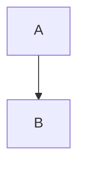

# Use Case — Markdown Fences Highlighted With One Adapter

> Route every fenced code block in the docs renderer through the same highlight adapter, so fences and standalone code previews never diverge. Source: https://tanstack.com/highlight/latest (accessed 2026-10-20)

## 1. Keep one adapter between the renderer and the package

```ts
// src/highlight/adapter.ts
import { highlight } from "@tanstack/highlight"
import MarkdownIt from "markdown-it"

export function highlightToHtml(code: string, language: string): string {
  return highlight(code, { language })
}
```

`markdown-it` receives this function through its `highlight` option; nothing else in the app imports the package. Confirm the entry name against `https://tanstack.com/highlight/latest` before writing it — v1 may still refine exports.

## 2. Wire the fence renderer

```ts
// src/docs/markdown.ts
import MarkdownIt from "markdown-it"
import { highlightToHtml } from "../highlight/adapter"

const md = new MarkdownIt({
  html: false,
  linkify: true,
  highlight(code, lang) {
    if (!lang) return ""                 // empty string → markdown-it escapes the code itself
    try {
      return highlightToHtml(code, lang)
    } catch {
      return ""                          // unknown language → plain escaped block, never a 500
    }
  },
})
```

Two rules make this safe:

- Return token HTML only. `markdown-it` still wraps the result in `<pre><code class="language-x">`, so returning a full `<pre>` produces nested preformatted blocks.
- An empty return means "fall back to escaped text". That is the correct answer for an unknown fence language and for a language you deliberately don't ship.

## 3. Keep the language on the wrapper

```ts
md.renderer.rules.fence = (() => {
  const defaultFence = md.renderer.rules.fence!
  return (tokens, idx, options, env, self) => {
    const html = defaultFence(tokens, idx, options, env, self)
    return html.replace("<pre>", `<pre data-lang="${tokens[idx].info.trim()}">`)
  }
})()
```

The `data-lang` attribute is what CSS hooks for per-language chrome (a filename bar, a copy button label). Reading `tokens[idx].info` gives the exact fence info string.

## 4. Support the two special fences explicitly

````md


```txt
raw output that must stay copyable
```
````

- Non-source fences (`mermaid`, `txt`, `diff`) must not be sent to the highlighter — register them as passthrough so they render escaped and copyable rather than erroring or losing whitespace.
- A `diff` fence keeps its `+`/`-` gutters only if the block is not tokenized as a source language; treat it as plain text and colour it with CSS.

## 5. Verify

1. `/run-test` — render a doc containing one fence per language the docs use, plus an unknown one; the unknown renders escaped and does not throw
2. Copy-paste from the browser — indentation and quotes survive (whitespace was not collapsed)
3. Toggle light/dark — fence tokens change colour without a re-render
4. `/run-typecheck` — the renderer override keeps `markdown-it` types
5. On failure → `/resolve-errors` max 3 rounds

## Pitfalls

- Returning a full `<pre>` from the `highlight` option → `<pre><pre><code>` and a broken layout.
- Throwing on an unknown language instead of falling back → one bad fence breaks the whole page render.
- Highlighting at runtime on the client for static docs → each page pays the grammar cost; precompute at build time (see `precompute-at-build-time.md`).
- Adding a per-language CSS file that hard-codes colours → the theme switch needs a second highlight pass; map tokens to CSS variables instead.
- Escaping the code a second time after the highlighter already escaped it → visible `&lt;div&gt;` in the page.

## Related

- `references/apis.md`
- `best-practices/tanstack-highlight.md`
- `usecases/highlight-code-block.md`
- `usecases/precompute-at-build-time.md`
