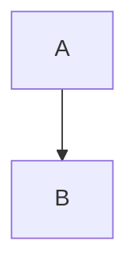

# Use Case — Markdown Fences Highlighted With One Adapter

> Route every fenced code block in the docs renderer through the same highlight adapter, so fences and standalone code previews never diverge. Source: https://tanstack.com/highlight/latest (accessed 2026-10-20)

## 1. Keep one adapter between the renderer and the package

```ts
// src/highlight/adapter.ts
import { highlight } from "@tanstack/highlight"

export function highlightTokens(code: string, language: string): string {
  return highlight(code, { language })
}
```

The markdown layer imports this adapter and nothing else imports the package. Confirm the entry name against `https://tanstack.com/highlight/latest` before writing it — v1 may still refine exports.

## 2. Swap the fence node in the Sätteri HAST

Sätteri renders Markdown to HAST, so the adapter's token HTML has to become the `<pre>` node that replaces the fence. There is no `highlight` option to hand it to.

```ts
// src/docs/markdown.ts
import { markdownToHast, htmlToHast, hastToHtml } from "satteri"
import { highlightTokens } from "../highlight/adapter"

type Node = {
  type: string
  tagName?: string
  value?: string
  properties?: Record<string, unknown>
  children?: Node[]
}

const languageOf = (pre: Node): string | null => {
  const className = pre.properties?.className ?? pre.properties?.class
  const names = Array.isArray(className)
    ? className
    : typeof className === "string"
      ? className.split(/\s+/)
      : []
  const match = names.find((name) => name.startsWith("language-"))
  return match ? match.slice("language-".length) : null
}

const textOf = (node: Node): string =>
  node.children?.map((child) => child.value ?? "").join("") ?? ""

const fenceHtml = (code: string, lang: string): string =>
  `<pre data-lang="${lang}"><code class="language-${lang}">${highlightTokens(code, lang)}</code></pre>`

const walk = (node: Node): void => {
  if (!node.children) return
  for (let i = 0; i < node.children.length; i++) {
    const child = node.children[i]
    if (child.tagName === "pre") {
      const lang = languageOf(child)
      const code = child.children?.find((n) => n.tagName === "code")
      if (lang && code) {
        const parsed = htmlToHast(fenceHtml(textOf(code), lang))
        const replacement = parsed.children.find((n) => n.type === "element")
        if (replacement) {
          node.children[i] = replacement
          continue
        }
      }
    }
    walk(child)
  }
}

export function renderMarkdown(source: string): string {
  const tree = markdownToHast(source, { position: false })
  walk(tree as Node)
  return hastToHtml(tree)
}
```

Three rules make this safe:

- Serialize the token HTML inside a `<pre><code>` you build yourself. The adapter returns tokens only, so nothing else supplies the wrapper.
- Take the first `element` child of the parsed fragment, not `children[0]` — `htmlToHast` may emit leading whitespace text nodes.
- Leave the node untouched when the language is unknown or the adapter throws. Sätteri's own `<pre><code>` output already carries escaped text, so the block still renders and stays copyable.

A throw on one bad fence is not acceptable in a docs build; wrap `highlightTokens` in `try/catch` and fall through to the untouched node if the package throws on an unregistered language.

## 3. Keep the language on the wrapper

`data-lang` is stamped in `fenceHtml`, so it survives on the replacement node:

```html
<pre data-lang="ts"><code class="language-ts">…tokens…</code></pre>
```

The attribute is what CSS hooks for per-language chrome (a filename bar, a copy-button label). It is read from the fence info string Sätteri already turned into `class="language-…"`, which is why `languageOf` parses the class list rather than the source.

## 4. Support the two special fences explicitly

````md


```txt
raw output that must stay copyable
```
````

- Non-source fences (`mermaid`, `txt`, `diff`) must not reach the adapter. Keep a passthrough list and return before `highlightTokens`, so the block renders escaped and copyable rather than erroring or losing whitespace.
- A `diff` fence keeps its `+`/`-` gutters only if the block is not tokenized as a source language; treat it as plain text and colour it with CSS.
- Unknown-but-code fences (a language the highlighter does not ship) follow the same passthrough path. Do not add them to a “supported languages” map just to silence an error.

```ts
const PASSTHROUGH = new Set(["mermaid", "txt", "text", "diff"])

const lang = languageOf(child)
if (lang && !PASSTHROUGH.has(lang)) {
  // replace with highlighted node
}
```

## 5. Verify

1. `/run-test` — render a doc containing one fence per language the docs use, plus an unknown one; the unknown renders escaped and does not throw
2. Copy-paste from the browser — indentation and quotes survive (whitespace was not collapsed)
3. Toggle light/dark — fence tokens change colour without a re-render
4. `/run-typecheck` — the tree walk keeps `satteri`'s HAST types; avoid `any` leaking into callers
5. On failure → `/resolve-errors` max 3 rounds

## Pitfalls

- Replacing the `<pre>` with a fragment whose first child is whitespace → an empty block and the highlighted markup dropped. Find the first `element` node.
- Passing the whole `<pre><code>` markup through the adapter → nested preformatted blocks, because Sätteri already wraps the fence.
- Throwing on an unknown language instead of leaving the node untouched → one bad fence breaks the whole page render.
- Reading `code.children[0].value` only → multi-span token streams lose everything after the first node. Join the text children.
- Highlighting at runtime on the client for static docs → each page pays the grammar cost; precompute at build time (see `precompute-at-build-time.md`).
- Adding a per-language CSS file that hard-codes colours → the theme switch needs a second highlight pass; map tokens to CSS variables instead.
- Escaping the code a second time after the highlighter already escaped it → visible `&lt;div&gt;` in the page.

## Related

- `references/apis.md`
- `best-practices/tanstack-highlight.md`
- `usecases/highlight-code-block.md`
- `usecases/precompute-at-build-time.md`
