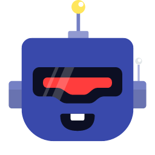

## Goal

Ship a bot project per a plan or GitHub issue: create the project, implement handlers, tests, CI/CD, deploy, and open a PR

## Reference Code

- Read the reference from `D:\newkub\github-ship-bots`
- For a new deploy, work inside `D:\newkub\github-ship-bots`
- Update the repo after shipping a new bot version

## Scope

- Accept a plan from an issue, file, or argument
- Create the bot project per the chosen stack
- Implement handlers, business logic, tests
- Run verify, CI/CD, deploy
- Create a PR with evidence
- Update the issue status

- See also: /setup-cicd, /open-github

## Execute

### 1. Read Plan

> Goal: Read the plan
1. Take `<issue-or-plan>` from the argument
   - issue: `/use-github-ship-bots 42`
   - plan file: `/use-github-ship-bots .devin/temp/plan/<workspace>/feed-bot.md`
2. If it is an issue → use `/resolve-github-issue-by-me` or `gh issue view <number>` (gh CLI `2.101.0 (verified 2026-09-26)`)
3. If it is a file → read `.devin/temp/plan/<workspace>/<file>.md`
4. Identify the bot type, platform, features, acceptance criteria
5. If unclear → run `/ask-me`

### 2. Choose Bot Stack

> Goal: Choose the bot stack
1. GitHub bot (approve/reject buttons) → `/follow-create-bot`
2. Web dashboard bot → `/follow-create-web`
3. CLI bot → `/follow-create-bun-cli`
4. Record the stack, rationale, dependencies

### 3. Create Project

> Goal: Create the project
1. Create the `{bot-name}/` directory or a new repo
2. Use `/follow-create-bot` to scaffold the skeleton
3. Create a `bot/<name>` branch if working in an existing repo
4. Set up `.env.example`, `tsconfig.json`, `package.json`

### 4. Implement Core Features

> Goal: Implement the core features
1. Create `src/handlers/` for the events the plan specifies
2. Create `src/domain/` for business logic
3. Add approve/reject buttons or slash commands if present
4. Connect to `D:\newkub\github-ship-bots` if this is a GitHub ship bot (path exists — verified 2026-09-26)
5. Run `/run-lint` and `/run-typecheck` while implementing

### 5. Add Tests

> Goal: Add tests
1. Create `test/handlers/` with fixtures
2. Mock Octokit API calls
3. Run `bun test` (Bun `1.4.2 (verified 2026-09-26)` — use `bun test --parallel` if the tests are independent)
4. Check idempotency and error handling

### 6. Verify

> Goal: Verify
1. Run `/run-verify`
2. Check secrets and example env
3. Check that `README.md` covers install, config, deploy

### 7. Commit And Push

> Goal: Commit and push
1. Run `/git-commit`
2. Run `/git-push`
3. Record the commit hash

### 8. Create PR

> Goal: Create the PR
1. Use `/create-github-pr`
2. Include `Closes #<issue>` in the PR body
3. Attach screenshots, test results, staging preview

### 9. Monitor And Deploy

> Goal: Monitor and deploy
1. Use `/resolve-cicd` to watch CI/CD
2. If passing → merge the PR
3. If there is a deploy → use `/deploy-to-cloudflare` or `/deploy-to-vercel`
4. Verify the bot works on production

### 10. Update Issue

> Goal: Update the issue
1. Update the checkboxes in the issue
2. Record the deployed URL and version
3. Run `/report-progress`

## Rules

- Do not start implementing if the plan is unclear
- Use `/create-plan-in-dot-agents` if a new plan is needed
- Use `/resolve-github-issue-by-me` when starting implementation from an issue
- Keep webhook wiring separate from business logic
- Wrap every handler in `try/catch`
- Never hardcode secrets
- Every feature must have a test
- Every PR with UI must have annotated screenshots
- No mockups/placeholders in a PR
- Do not deploy if verification fails

- Use /resolve-errors if needed

## Expected Outcome

- The bot project is created per the plan
- Handlers, tests, CI/CD are complete
- The PR is created with evidence
- The bot is deployed and working on production
- The issue progress is updated
